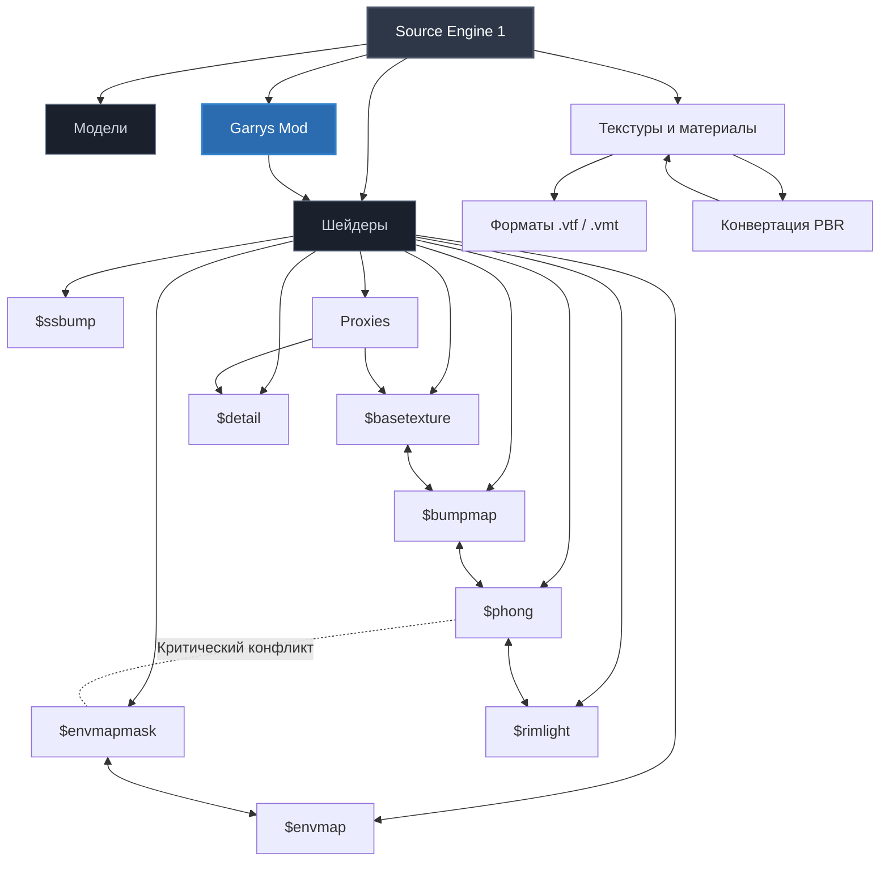

# 🧠 Source Engine 1 — Personal Knowledge Base

Добро пожаловать в персональную базу знаний (Digital Second Brain), посвященную архитектуре, материалам, шейдерному конвейеру и моддингу на движке **Source Engine 1**. 

База данных спроектирована по методу **Zettelkasten** и оптимизирована для работы в приложении **Obsidian**. Все материалы взаимосвязаны через нелинейную систему внутренних ссылок `[[WikiLinks]]`. В качестве сквозного технического примера для большинства инструкций используется игра **Garry's Mod**.

---

## 🗺️ Карта взаимосвязей (Knowledge Graph)

Ниже представлена визуальная структура базы знаний. Каждый узел — это отдельная статья, раскрывающая конкретную технологию или параметр движка:



---

## 📂 Структура репозитория

Репозиторий организован в виде стандартного хранилища (Vault) Obsidian:

```text
.
├── 📐 Shaders/                 # Статьи по шейдерам и их параметрам
│   ├── \$basetexture.md        # Базовые альбедо-карты и UV-матрицы
│   ├── \$bumpmap.md            # Специфика DirectX нормалей и инверсия каналов
│   ├── \$detail.md             # Микродетализация и режимы блендинга
│   ├── \$envmap.md             # Зеркальные отражения внутриигровых кубмапов
│   ├── \$envmapmask.md         # Спекулярные маски и оптимизация альфа-каналов
│   ├── \$phong.md              # Динамический блик Фонга и Fresnel эффекты
│   ├── \$rimlight.md           # Силуэтная/контурная подсветка моделей
│   └── \$ssbump.md             # Рельеф с запеченным самозатенением
│
├── 🛠️ Workflow/               # Пайплайны и пошаговые инструкции
│   ├── PBR_to_BlinnPhong.md   # Декомпозиция PBR-карт под стандарты DX9
│   ├── Proxies.md             # Динамические скрипты внутри VMT-материалов
│   └── Текстуры и материалы.md # Руководство по работе с VTF/VMT через VTFEdit
│
├── 🎮 Platform/               # Платформозависимые особенности
│   ├── Введение в Source.md   # Общий обзор движка и его ограничений
│   └── Garry's Mod.md         # Особенности рендеринга и лимиты в GMod
│
└── 📦 Models/                 # Трехмерные ассеты и компиляция
    └── Модели.md              # Анатомия .qc скриптов и структуры компиляции
```

---

## ⚙️ Технический стек и инструментарий базы знаний

Все статьи написаны практикующим разработчиком контента и учитывают суровые технические ограничения архитектуры **DirectX 9**:
* **Модель освещения:** Модифицированный Blinn-Phong (вместо современного PBR).
* **Стандарты нормалей:** DirectX Standard (**Inverted Y / Y-**).
* **Конфликты конвейера:** Документированы аппаратные лимиты интерполяторов пиксельного шейдера, вылеты движка из-за типов данных в `Proxies` и конфликты масок Phong/Envmap.

---

## 🚀 Как использовать эту базу в локальном Obsidian

1. Склонируйте данный репозиторий на свой ПК:
   ```bash
   git clone https://github.com/KREDOOM/Source-Engine-1
   ```
2. Откройте приложение **Obsidian**.
3. Выберите **"Открыть папку как хранилище" (Open folder as vault)**.
4. Укажите путь к склонированной папке.
5. Нажмите `Ctrl + G` (или `Cmd + G` на Mac), чтобы открыть интерактивный граф связей и начать нелинейную навигацию по статьям.

---
**Дисклеймер:** Движок старый, местами нелогичный и сложный для современного пайплайна (настоящий инструментальный ад). Но знание этих костылей — единственный способ заставить старый Source выдавать кинематографичную картинку в Garry's Mod. 

*База знаний находится в процессе активного наполнения. Pull Requests с исправлением багов и описанием редких прокси приветствуются!*
