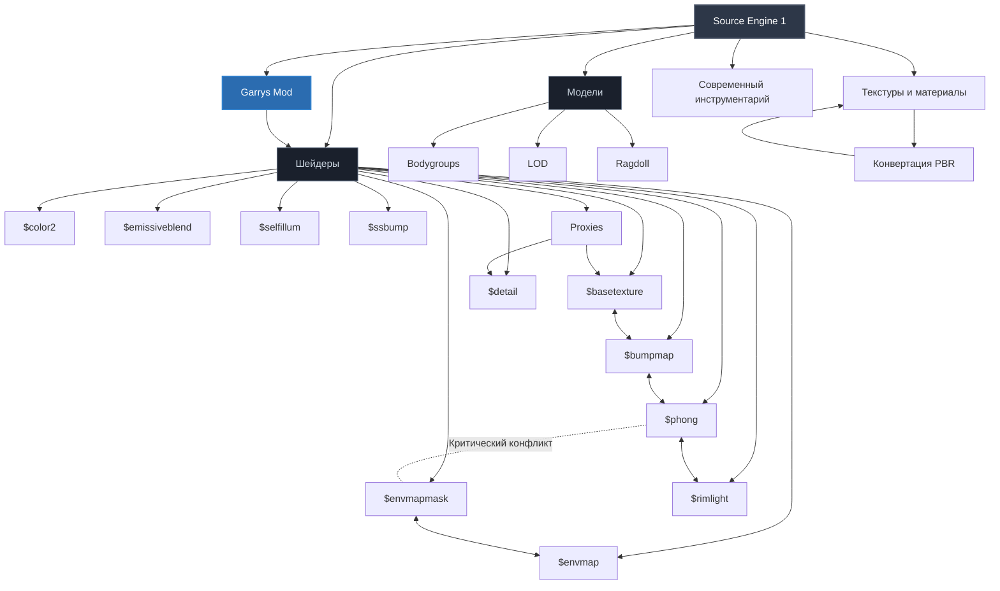

# 🧠 Source Engine 1 — Personal Knowledge Base

Добро пожаловать в персональную базу знаний (Digital Second Brain), посвященную архитектуре, материалам, шейдерному конвейеру и моддингу на движке **Source Engine 1**. 

База данных спроектирована по методу **Zettelkasten** и оптимизирована для работы в приложении **Obsidian**. Все материалы взаимосвязаны через нелинейную систему внутренних ссылок `[[WikiLinks]]`. В качестве сквозного технического примера для большинства инструкций используется игра **Garry's Mod**.

---

## 🗺️ Карта взаимосвязей (Knowledge Graph)

Ниже представлена визуальная структура базы знаний. Каждый узел — это отдельная статья, раскрывающая конкретную технологию или параметр движка:



---

## 📂 Структура репозитория

Репозиторий организован в виде стандартного хранилища (Vault) Obsidian:

```text
.
├── README.md                    # Эта страница: карта базы и инструкция по запуску
├── TODO.md                      # Задачи: Substance-графы, сообщество, Dataview
├── Source Engine 1.md           # Введение: история, ветки, боли движка
├── Garrys Mod.md                # Особенности рендеринга и лимиты GMod
├── Модели.md                    # Studio Models: .mdl/.vvd/.vtx/.phy и .qc
├── Bodygroups.md                # Бодигруппы и $texturegroup
├── LOD.md                       # Уровни детализации и removebone
├── Ragdoll.md                   # Рэгдолл, VPhysics и хитбоксы
├── Текстуры и материалы.md      # VTF/VMT: анатомия файла и синтаксис
├── Современный инструментарий.md # Blender, Crowbar, VTFEdit, Hammer++
├── Инструменты.md               # Hammer++/Crowbar/VTFEdit++: скриншоты и ссылки
│
├── VMT/                         # Шейдерный конвейер: параметры материалов
│   ├── Шейдеры.md               # Классификация шейдеров и лимиты DX9
│   ├── $basetexture.md          # Альбедо-карты и UV-матрицы
│   ├── $bumpmap.md              # Нормали DirectX и упаковка масок
│   ├── $color2.md               # Динамическая покраска моделей
│   ├── $detail.md               # Микродетализация и блендинг
│   ├── $emissiveblend.md        # Анимированное самосвечение
│   ├── $envmap.md               # Кубмапы и зеркальные отражения
│   ├── $envmapmask.md           # Спекулярные маски и альфа-каналы
│   ├── $phong.md                # Блик Фонга и Fresnel-эффекты
│   ├── $rimlight.md             # Контурная подсветка
│   ├── $selfillum.md            # Статичное самосвечение
│   ├── $ssbump.md               # Рельеф с самозатенением
│   ├── PBR.md                   # Конвертация PBR в Blinn-Phong
│   └── Proxies.md               # Динамические скрипты внутри VMT
│
├── _resources/                  # Вложения vault: картинки и Substance-графы (.sbs)
│   ├── *.jpg / *.png            # Иллюстрации к статьям (эмбеды по имени файла)
│   └── *.sbs                    # PBR_to_BlinnPhong, RE_Engine, Warframe_color_reconstruction
│
└── .obsidian/                   # Конфиг vault: плагины, тема, граф
```

> **Obsidian-first:** заметки связаны wikilink'ами `[[...]]`, картинки вставляются эмбедами `![[имя файла]]` (Obsidian находит их по имени в `_resources/`). На GitHub wikilink'и не кликабельны — для веб-просмотра используйте граф выше и ссылки в статьях. Папка вложений настроена в `.obsidian/app.json` (`attachmentFolder: _resources`), поэтому новые вставки из буфера складываются сюда же.

Актуальные задачи и планы развития — в заметке [[TODO]].

---

## ⚙️ Технический стек и инструментарий базы знаний

Все статьи написаны практикующим разработчиком контента и учитывают суровые технические ограничения архитектуры **DirectX 9**:
* **Модель освещения:** Модифицированный Blinn-Phong (вместо современного PBR).
* **Стандарты нормалей:** DirectX Standard (**Inverted Y / Y-**).
* **Конфликты конвейера:** Документированы аппаратные лимиты интерполяторов пиксельного шейдера, вылеты движка из-за типов данных в `Proxies` и конфликты масок Phong/Envmap.

---

## 🚀 Как использовать эту базу в локальном Obsidian

1. Склонируйте данный репозиторий на свой ПК:
   ```bash
   git clone https://github.com/KREDOOM/Source-Engine-1
   ```
2. Откройте приложение **Obsidian**.
3. Выберите **"Открыть папку как хранилище" (Open folder as vault)**.
4. Укажите путь к склонированной папке.
5. Нажмите `Ctrl + G` (или `Cmd + G` на Mac), чтобы открыть интерактивный граф связей и начать нелинейную навигацию по статьям.

---
**Дисклеймер:** Движок старый, местами нелогичный и сложный для современного пайплайна (настоящий инструментальный ад). Но знание этих костылей — единственный способ заставить старый Source выдавать кинематографичную картинку в Garry's Mod. 

*База знаний находится в процессе активного наполнения. Pull Requests с исправлением багов и описанием редких прокси приветствуются!*
